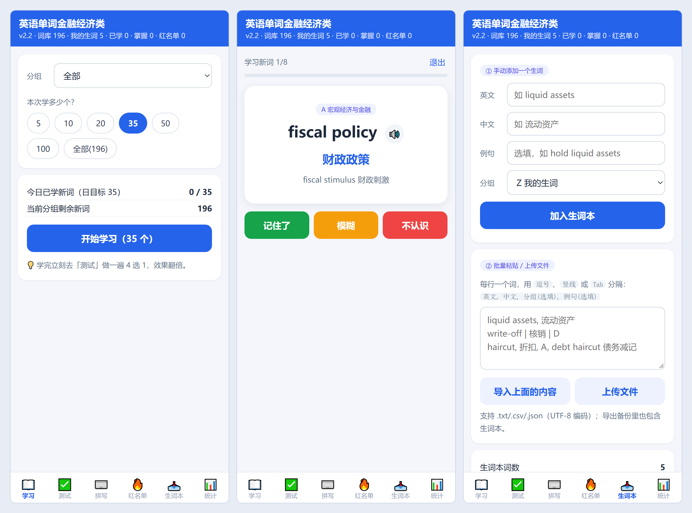

# 自律型英语单词背诵 · Word Trainer

[English](README_EN.md) | **简体中文**

> 一个为自己学习单词准备的背单词网页应用。

🔗 **在线使用**：https://violetcodt.github.io/word-trainer/

---

## 📸 界面预览



---

## ✨ 功能特性

| 模块 | 说明 |
| --- | --- |
| 📖 学习新词 | 每天 0-35 个，点击卡片翻释义，支持英语自动发音 |
| ✅ 选择测试 | 英 → 中 4 选 1，即时判分并高亮正确答案 |
| ⌨️ 拼写测试 | 中 → 英 默写，检验是否真的会拼 |
| 🔥 红名单 | 自动收集错词，一键重刷，可导出 `txt` |
| 📥 生词本 | 手动添加 / 批量粘贴 / 上传文件，导入自己的生词并纳入复习 |
| 📊 统计 | 分组进度条、已学 / 已掌握 / 红名单 / 今日新学 |
| 🧠 间隔重复 | 优先级 = 错次 × 3 − 对次 + 距上次复习天数 |
| 🔊 发音朗读 | 系统语音（Web Speech API）优先，可切换为在线发音，失败自动降级 |
| 💾 数据备份 | 进度与生词本存本地，支持导出 / 导入 `json` 备份 |
| 📱 移动优先 | 响应式布局，支持添加到主屏幕（PWA 风格） |

## 🚀 快速开始

### 手机使用
直接打开在线地址，然后：
- **iPhone（Safari）**：分享 → 添加到主屏幕
- **Android（Chrome）**：⋮ → 添加到主屏幕

### 电脑使用
浏览器打开 `index.html` 即可，无需安装任何环境。

### 本地运行
```bash
git clone https://github.com/violetcodt/word-trainer.git
cd word-trainer
# 双击 index.html，或起一个静态服务器：
python -m http.server 8000
```

> 若仓库里的入口文件不叫 `index.html`（例如改名为 `index_v2.html`），访问时需要在地址后面带上文件名：`https://violetcodt.github.io/word-trainer/index_v2.html`。

## 📥 添加自己的生词

内置词库共 191 词，按语义分为 5 组，自定义词统一进入 **Z 组「我的生词」**，并且会自动接入学习、测试、拼写、红名单与统计，不需要额外操作。

| 分组 | 内容 |
| --- | --- |
| **A** | 宏观经济与金融（通胀、货币政策、汇率、杠杆…） |
| **B** | 银行 · 监管 · 保险（审慎监管、拨备、反洗钱…） |
| **C** | 科技与新技术（人工智能、区块链、网络安全…） |
| **D** | 商业与企业（并购、反垄断、治理、常用动词） |
| **E** | 逻辑衔接与题干（however、infer、tone…） |
| **Z** | 我的生词（自己添加的词） |

### 1. 手动添加
在「📥 生词本」填写 英文 / 中文 / 例句（选填）/ 分组，点击「加入生词本」。分组默认 Z，也可以直接归到 A–E 任意一组。

### 2. 批量粘贴
每行一个词，字段用 **逗号、竖线 `|`、Tab 或分号** 分隔：

```text
english, chinese, 分组(选填), 例句(选填)

liquid assets, 流动资产
write-off | 核销 | D
haircut, 折扣, A, debt haircut 债务减记
```

- 第三列写**单个字母 A–E** 时识别为分组，写其他内容则视为例句。
- 以 `#` 开头的行会被忽略，可当注释用。
- 导入后提示 `✅ 新增 5 · 更新 1 · 跳过 2（重复或信息不全）`；已在**内置词库**中的词会自动跳过。

### 3. 上传文件
支持 `.txt` / `.csv` / `.json`，请保存为 **UTF-8** 编码。JSON 支持两种写法：

```json
[{ "en": "spread", "zh": "价差", "g": "A", "p": "bid-ask spread 买卖价差" }]
```

```json
[["yield curve", "收益率曲线", "A"]]
```

## ❓ 常见问题

**Q：没有声音？**
① 检查手机静音键；② 用系统浏览器直接打开（不要在微信/QQ 内置浏览器里）；③ 统计页把「发音方式」改为「仅在线发音」；④ 点一次「测试发音」确认。

**Q：下载了文件、上传后中文乱码？**
文件不是 UTF-8 编码。用编辑器另存为 UTF-8，或直接把内容复制到「批量粘贴」文本框导入。

**Q：进度会丢吗？换设备能同步吗？**
进度只存在当前浏览器的 `localStorage`（键名 `jmj_words_v1`），不上传服务器。换设备时：旧设备「导出进度备份」得到 `word_progress_日期.json`，新设备「导入进度备份」选择该文件即可，**备份里包含生词本**。

**Q：自定义的词能删除吗？**
可以，在生词本列表里逐条删除，或点「清空生词本」（有二次确认）。注意「重置全部进度」只清学习进度，**不会**删除生词本。

## 🕒 更新日志

| 版本 | 说明 |
| --- | --- |
| **v2.2** | 新增「生词本」：手动添加 / 批量粘贴 / 文件上传自定义词，自动接入全部模块 |
| v2.1 | 发音方式可切换（自动 / 仅系统 / 仅在线），优化 iOS 语音解锁与防抖 |
| v2.0 | 新增拼写测试、红名单、统计页、进度备份导入导出 |
| v1.0 | 学习新词 + 选择测试基础版 |

## 📄 许可

[MIT License](LICENSE)，可自由修改自用。
